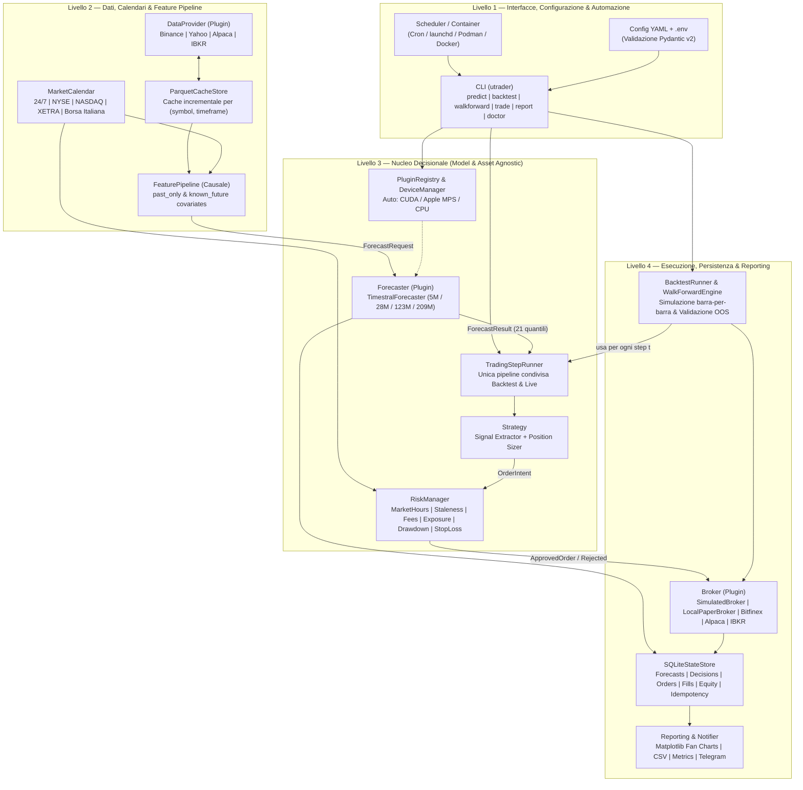

# Universal Trader — Implementation Plan

> **Documento di specifica architetturale e piano di implementazione** per un progetto greenfield (*from scratch*).
> Questo documento è autocontenuto e definisce obiettivi, principi guida, architettura, contratti, vincoli operativi, packaging (nativo + Docker/Podman) e roadmap a fasi per realizzare **Universal Trader**.

---

## 1. Obiettivi del Progetto

**Universal Trader** è una piattaforma modulare, portabile e *asset-agnostic* per la previsione probabilistica di serie temporali finanziarie, il backtesting realistico, l'ottimizzazione *walk-forward* e l'esecuzione automatizzata di strategie di trading (Paper, Live e Dry-Run).

Gli obiettivi primari sono:

1. **Motore previsionale intercambiabile (Timestral-first):**
   - Adottare **Mistral Timestral** (`mistralai/timestral`, varianti `5M`, `28M`, `123M`, `209M`) come motore previsionale iniziale, sfruttandone appieno le capacità native: previsioni probabilistiche su **21 quantili (`0.01`–`0.99`)**, contesto lungo fino a 32.768 step, architettura multivariata nativa, supporto distinto per covariate *past-only* e *known-future* (numeriche e categoriche) e gestione nativa dei valori mancanti (`NaN`).
   - Isolare completamente il modello dietro un'interfaccia astratta (`Forecaster`) affinché nuovi modelli previsionali o ensemble possano essere introdotti in futuro tramite plugin, senza toccare la logica di trading, il backtester o i broker.
2. **Generalità multi-asset (Crypto, Azioni, ETF, Forex):**
   - Disaccoppiare completamente la logica decisionale dall'asset scambiato: la stessa piattaforma deve poter operare su criptovalute (24/7, frazionabili) così come su azioni o ETF (calendari di borsa, orari RTH, festività, *Adjusted Close* per split/dividendi, lotti interi, commissioni fisse o percentuali).
   - Cambiare strumento finanziario, mercato, provider dati o broker deve richiedere esclusivamente la modifica di un file di configurazione YAML.
3. **Coerenza totale tra simulazione e produzione (Zero Backtest/Live Drift):**
   - Eseguire in backtest, in paper trading e in live trading esattamente lo stesso codice per feature engineering, inferenza, generazione segnali, position sizing e risk management.
4. **Affidabilità operativa e gestione del rischio:**
   - Garantire causalità stretta (assenza di *lookahead bias* e *data leakage*), validazione *out-of-sample* (Walk-Forward), layer dedicato di Risk Management, stato persistente con idempotenza su SQLite e reportistica/alerting (grafici, CSV, Telegram).
5. **Portabilità universale (Hardware e Ambiente):**
   - Supportare nativamente **CPU**, **GPU NVIDIA (CUDA)** e **Apple Silicon (MPS)**.
   - Essere eseguibile su qualsiasi nuova macchina tramite un semplice `git clone` e un singolo comando di bootstrap, sia in ambiente Python isolato (`uv`) sia containerizzato con **Docker** e **Podman** (OCI-compliant).

---

## 2. Principi Guida

1. **Architettura Esagonale (Ports & Adapters):** il nucleo di dominio (`core`, `strategies`, `risk`, `engine`) definisce i contratti (`Protocol` + modelli Pydantic immutabili) e non ha dipendenze dirette da librerie ML, provider dati, exchange o canali di notifica. Tutti i dettagli esterni vivono in adapter intercambiabili registrati in un `PluginRegistry`.
2. **Single Execution Pipeline:** nessuna logica di segnale, sizing o controllo rischio viene duplicata tra backtest e live. Il backtester è un harness che itera storicamente lo stesso `TradingStepRunner` usato dal bot live, collegandolo a un `SimulatedBroker`.
3. **Causalità Rigorosa & Fail-Fast:**
   - Ogni trasformazione di feature o normalizzazione usa solo dati $\le t$ (finestre mobili causali; nessuna statistica globale sull'intero dataset).
   - Se una fonte dati critica o un'API broker fallisce, la pipeline si ferma in modo esplicito e registra l'errore: **mai** generare dati sintetici o fallback silenziosi in produzione.
4. **Configuration-as-Code Tipizzata:** tutte le configurazioni sono dichiarative (YAML), validate all'avvio tramite **Pydantic v2** (errore immediato su parametri invalidi), con i segreti iniettati esclusivamente via variabili d'ambiente (`.env` / secret manager) tramite sintassi `${ENV_VAR}`.
5. **Distributions-First:** le decisioni di trading e di rischio operano sull'intera distribuzione probabilistica prodotta dal modello (quantili), non su una singola stima puntuale.
6. **Portabilità & Riproducibilità by Design:** zero path assoluti nel codice o nei config, dipendenze bloccate (`uv.lock`), cache e stato separati dal codice sorgente, container OCI rootless compatibili con Podman e Docker.
7. **Osservabilità e Idempotenza:** ogni esecuzione produce log strutturati e persiste su SQLite input, previsioni, decisioni del RiskManager, ordini e fill; l'idempotenza per `(instrument, timeframe, candle_timestamp)` impedisce ordini duplicati in caso di riavvii o retry dello scheduler.

---

## 3. Schema Architetturale di Alto Livello



### Flusso Dati End-to-End di un Singolo Step (`TradingStepRunner`)
1. **Caricamento dati:** `DataProvider` (tramite `ParquetCacheStore`) restituisce candele OHLCV normalizzate in UTC per l'`Instrument` configurato.
2. **Feature Engineering:** `FeaturePipeline` costruisce in modo strettamente causale la serie target e i dizionari `past_covariates` (lunghezza $T$) e `future_covariates` (lunghezza $T + H$, derivati da `MarketCalendar` o eventi noti).
3. **Previsione:** `Forecaster` (`TimestralForecaster`) esegue l'inferenza sul device selezionato (`cuda` / `mps` / `cpu`) e restituisce un `ForecastResult` contenente la mappa dei quantili (es. `0.01..0.99`).
4. **Valutazione Strategia:** `Strategy` confronta la distribuzione prevista con il prezzo di mercato corrente (`Quote` dal `Broker`) e il `PortfolioState`, producendo eventualmente un `OrderIntent` (`BUY` / `SELL` / `HOLD` + frazione target).
5. **Controllo Rischio:** `RiskManager` applica la catena di guardie (mercato aperto, freschezza dati, copertura commissioni fisse/percentuali, limiti esposizione, arrotondamento a `qty_step`/`fractional`, drawdown circuit breaker, stop-loss) producendo un `ApprovedOrder` oppure un `RejectedOrder` motivato.
6. **Esecuzione & Audit:** in caso di approvazione, il `Broker` esegue l'ordine (`SimulatedBroker` in backtest, `LocalPaperBroker` o broker reale in paper/live). Previsione, decisione, ordine, fill ed equity vengono salvati in `SQLiteStateStore` e inviati ai `Notifier` configurati.

---

## 4. Descrizione delle Componenti Architetturali

### 4.1 `core/` — Modello di Dominio, Contratti e Configurazione
- **`models.py` (Entità immutabili Pydantic):**
  - `Instrument`: descrive in modo canonico qualsiasi asset (`id`, `asset_class` [`crypto` | `equity` | `etf` | `forex`], `base`, `quote_currency`, `calendar`, `fractional`, `min_qty`, `qty_step`, `min_notional`, `provider_symbols`).
  - `MarketSnapshot`: ultimo stato osservato (candele recenti, quote bid/ask/last, timestamp UTC).
  - `ForecastRequest` / `ForecastResult`: contratto standard di input/output del motore previsionale. `ForecastResult` espone `quantiles: dict[float, np.ndarray]` e metodi helper (`.median`, `.quantile(q)` con interpolazione lineare se un quantile esatto manca, `.iqr()`, `.expected_return(price)`, `.downside_tail(q=0.05)`).
  - `PortfolioState`, `Position`, `OrderIntent`, `ApprovedOrder`, `FillResult`.
- **`protocols.py`:** definisce i `typing.Protocol` per `DataProvider`, `Forecaster`, `Strategy`, `RiskGuard`, `Broker`, `StateStore`, `Notifier`.
- **`config.py`:** carica e valida i file YAML, risolve le variabili `${ENV_VAR}` leggendo da ambiente/`.env`, impedisce l'avvio con configurazioni incoerenti (es. `horizon > model.max_horizon` o `fractional=False` con quantità decimale).
- **`registry.py`:** registro estensibile (`@register_forecaster("timestral")`, `@register_broker("alpaca")`, ecc.) che istanzia dinamicamente i componenti dichiarati nello YAML.
- **`calendar.py`:** astrazione sui calendari di borsa (via `exchange_calendars` per azioni/ETF come `XNYS`, `XNAS`, `XETR`, `XMIL`, più calendario nativo `24/7` per crypto). Fornisce `is_market_open(ts)`, `next_session_open(ts)`, `sessions_per_year()` e `bars_per_year(timeframe)` per calcolare correttamente Sharpe/Sortino per ogni asset class.

### 4.2 `data/` — Acquisizione Dati, Caching e Feature Causali
- **Data Providers (Adapter):**
  - `YahooDataProvider`: azioni, ETF, indici macro e crypto; gestisce nativamente `adj_close` per evitare distorsioni da split/dividendi azionari.
  - `BinanceDataProvider`: dati crypto spot OHLCV ad alta granularità (`1m`–`1d`) con paginazione robusta e backoff esponenziale.
  - `AlpacaDataProvider` (e predisposizione `IBKRDataProvider`): dati azionari intraday e giornalieri regolamentati.
  - `CsvParquetProvider`: caricamento dataset offline locali per test e ricerca riproducibile.
- **`ParquetCacheStore`:** decorator applicabile a qualsiasi `DataProvider`. Memorizza i dati in formato Apache Parquet partizionati per `(provider, instrument_id, timeframe)` e implementa **aggiornamento incrementale** (scarica solo l'intervallo mancante rispetto alla cache locale).
- **`FeaturePipeline`:**
  - Costruisce due gruppi distinti di covariate:
    - **`past_only`** (note solo fino a $t$): `volume`, log-rendimenti, volatilità realizzata rolling, proxy di pressione del book calcolata con normalizzazione **strettamente rolling** (zero leakage), serie macro allineate con `merge_asof(direction="backward")` (es. VIX, S&P500, Nasdaq, Gold, DXY, Treasury 10Y).
    - **`known_future`** (note fino a $t + H$): encoding ciclici temporali (`hour_sin/cos`, `dow_sin/cos`, `month_sin/cos`), flag di sessione borsistica (`is_market_open`, `is_pre_holiday`), calendari macro noti.
  - Gestisce i valori mancanti in base alle capability del modello: lascia `np.nan` intatti per modelli che li supportano nativamente (come Timestral) o applica imputazione causale (`ffill`) quando richiesto.

### 4.3 `forecasters/` — Motore Previsionale e Gestione Hardware
- **`device.py` (`DeviceManager`):**
  - Rileva e risolve il backend di calcolo secondo priorità configurabile (`auto` $\rightarrow$ `cuda` $\rightarrow$ `mps` $\rightarrow$ `cpu`, oppure forzato via config/env `UTRADER_DEVICE`).
  - Gestisce il `dtype` sicuro per backend (`float32` su Apple Silicon MPS e CPU; `bfloat16`/`float32` configurabile su CUDA) e fornisce un meccanismo di fallback controllato su CPU (con warning esplicito nei log) qualora un operatore PyTorch non risulti supportato su MPS.
  - Configura la directory di cache Hugging Face in modo relativo al progetto/volume (`HF_HOME`), mai hardcoded.
- **`timestral_adapter.py` (`TimestralForecaster`):**
  - Unico motore implementato nella v1. Wrappa `TimestralForecaster.from_pretrained("mistralai/Timestral-{5M|28M|123M|209M}")` dalla libreria ufficiale `mistralai/timestral`.
  - Supporta:
    - Caricamento *lazy* e riutilizzo del modello in memoria su tutto il ciclo di vita (essenziale nel walk-forward).
    - Inferenza singola (`predict`) e in batch (`predict_batch`) con chunking adattivo per non saturare VRAM / memoria unificata Apple Silicon.
    - Passaggio nativo di target, covariate *past-only*, *known-future* e categoriche, più gestione nativa di `np.nan`.
    - Mappatura di tutti i **21 quantili** (`0.01`–`0.99`) in `ForecastResult`.
- **Estensibilità futura:** l'aggiunta di un secondo modello (o di un `EnsembleForecaster` che aggrega più `Forecaster`) richiede solo un nuovo file in `forecasters/` registrato nel `PluginRegistry`.

### 4.4 `strategies/` — Generazione Segnali e Position Sizing
- **`signals.py` (`SignalExtractor`):** estrae metriche sintetiche dalla distribuzione `ForecastResult`:
  - `median_last` / `median_mean` / `median_peak` (rendimento atteso su mediana `q50`).
  - `prob_positive` (probabilità implicita dai quantili che il prezzo a scadenza superi il prezzo attuale + soglia).
  - `quantile_asymmetry` (rapporto upside `q90 - price` vs downside `price - q10`).
- **`sizing.py` (`PositionSizer`):** implementazioni modulari:
  1. `BinarySizer`: 100% allocazione / 100% liquidazione.
  2. `FractionalSizer`: frazione fissa configurabile (es. 50% o 25%) per accumulo/distribuzione graduale.
  3. `ProportionalSizer`: allocazione proporzionale alla forza del rendimento atteso.
  4. `VolatilityAdjustedSizer`: ridimensiona la posizione in base allo spread normalizzato `(q90 - q10) / price`.
  5. `DynamicKellySizer`: criterio di Kelly frazionario basato su rendimento atteso e deviazione standard stimata dai quantili ($f^* = \text{clip}(\frac{E[r]}{\sigma^2} \cdot K_{\text{risk}}, 0, 1)$).
  6. `TailRiskKellySizer` *(specifico per i 21 quantili di Timestral)*: penalizza l'esposizione usando la coda sinistra (`q05` / CVaR stimato) per proteggersi da eventi estremi asimmetrici.

### 4.5 `risk/` — Layer di Gestione del Rischio
Catena ordinata di guardie indipendenti (`RiskManager`):
1. **`MarketHoursGuard`:** verifica tramite `MarketCalendar` che il mercato sia aperto (attivo per azioni/ETF, bypassato per `24/7`).
2. **`DataStalenessGuard`:** rifiuta l'operatività se il timestamp dell'ultima candela supera `max_data_age`.
3. **`FeeAndSlippageGuard`:** calcola il costo stimato *round-trip* combinando fee percentuale, fee fissa minima per eseguito (`fixed_min`, tipica di broker azionari) e slippage atteso; blocca ordini con valore atteso netto negativo.
4. **`InstrumentConstraintGuard`:** arrotonda la quantità al `qty_step` dello strumento (es. `1` azione intera se `fractional=False`), applica una riserva di sicurezza sul cash disponibile e verifica `min_qty` e `min_notional`.
5. **`ExposureLimitGuard`:** garantisce che il peso dello strumento non superi `max_exposure_pct` del portafoglio.
6. **`DrawdownCircuitBreaker`:** confronta l'equity corrente con l'High-Water Mark in `SQLiteStateStore`; se il drawdown supera `max_drawdown_pct`, entra in stato `HALTED` (consente solo ordini di chiusura/riduzione rischio e invia alert urgente).
7. **`QuantileStopLossGuard`:** opzionalmente chiude posizioni aperte se il prezzo viola la soglia di stop-loss dinamico ancorata ai quantili inferiori (`q05`/`q10`) o a un trailing stop percentuale.

### 4.6 `brokers/` — Layer di Esecuzione Ordini
- **`SimulatedBroker`:** motore di simulazione per backtest/walk-forward. Modella commissioni percentuali + fisse minime, slippage in basis points, bid-ask spread, esecuzione configurabile a `open[t+1]` (default anti-lookahead) o `close[t]`, e vincoli di frazionamento dell'`Instrument`.
- **`LocalPaperBroker`:** broker di paper trading universale persistito su SQLite. Legge le quotazioni live dal `DataProvider` (o dal ticker del broker) ed esegue fill simulati realistici; permette di testare in tempo reale **qualsiasi azione, ETF o crypto** senza bisogno di un conto paper esterno.
- **`BitfinexBroker`:** adapter REST v2 (HMAC-SHA384) per trading spot crypto in modalità Paper (`tTEST...`) e Live.
- **`AlpacaBroker`:** adapter REST per azioni ed ETF USA in modalità Paper (gratuito) e Live.
- *(Predisposizione estensibile)* **`IBKRBroker`:** adapter per Interactive Brokers (azioni/ETF EU e US) via `ib_async`.

### 4.7 `engine/` — Orchestrazione, Backtesting & Walk-Forward
- **`runner.py` (`TradingStepRunner`):** esegue un singolo ciclo atomico completo (dati $\rightarrow$ feature $\rightarrow$ previsione $\rightarrow$ strategia $\rightarrow$ risk $\rightarrow$ broker $\rightarrow$ persistenza $\rightarrow$ notifica). Usato tal quale sia in live che in backtest.
- **`backtest.py` (`BacktestRunner`):** pre-calcola in batch le previsioni (con cache su disco opzionale) e invoca `TradingStepRunner` barra per barra con `SimulatedBroker`, restituendo storico equity, lista trade e metriche.
- **`walkforward.py` (`WalkForwardEngine`):**
  - Divide lo storico in finestre mobili/espansive $(W_{\text{train}}, W_{\text{test}})$ per prevenire l'overfitting.
  - Carica il checkpoint di Timestral **una sola volta** per taglia di modello e salva le previsioni in una cache su disco (`forecast_cache/`) indicizzata per hash di `(model_id, instrument, timeframe, context_len, horizon, features)`.
  - Seleziona i migliori iperparametri sulla finestra in-sample tramite score aggiustato per il rischio (es. Sharpe/Calmar con vincolo di minimo numero di trade) e valuta le performance aggregate esclusivamente sulle finestre **out-of-sample**.
- **`metrics.py`:** calcola metriche *calendar-aware*: ROI, Buy & Hold ROI, Outperformance, CAGR, Sharpe Ratio, Sortino Ratio, Calmar Ratio, Max Drawdown, Win Rate, Profit Factor, Turnover, costi totali (fee + slippage) e metriche di calibrazione del modello (**MAE, RMSE, Pinball Loss / Quantile Coverage** ex-post).

### 4.8 `storage/` e `reporting/`
- **`sqlite_store.py` (`SQLiteStateStore`):** schema leggero in SQLite (WAL mode) con tabelle `runs`, `forecasts`, `orders`, `fills`, `equity_snapshots`. Garantisce:
  - **Idempotenza:** chiave univoca su `(config_name, instrument_id, timeframe, candle_timestamp)` per impedire esecuzioni duplicate.
  - **Audit trail completo** e calcolo persistente dell'High-Water Mark per il circuit breaker.
  - **Valutazione ex-post:** confronta le previsioni passate salvate con i prezzi effettivamente realizzati.
- **`plots.py`:** genera grafici *fan chart* multi-quantile (`q05–q95`, `q10–q90`, `q25–q75`, mediana) e curve di equity/drawdown vs Buy & Hold.
- **`telegram.py` (`TelegramNotifier`):** invia report operativi e alert di errore/risk formattati dinamicamente in base a `Instrument`, `quote_currency` e `horizon` (nessun testo hardcoded su BTC o 24H).

### 4.9 `cli/` — Interfaccia Utente
CLI snella basata su **Typer** (o `argparse`), entry point installato `utrader`:
- `utrader doctor`: verifica ambiente, rilevamento hardware (CPU/CUDA/MPS), caricamento Timestral, accesso cache/SQLite e validità dei config.
- `utrader predict --config <file>`: esegue inferenza aggiornata e genera fan chart.
- `utrader backtest --config <file> --start YYYY-MM-DD --end YYYY-MM-DD`: simulazione storica completa + grafici + report metriche.
- `utrader walkforward --config <file> --start YYYY-MM-DD --end YYYY-MM-DD`: ottimizzazione e validazione out-of-sample + export CSV.
- `utrader trade --config <file> [--dry-run]`: esegue uno step operativo (singolo o schedulato via cron/container).
- `utrader report --db state/trader.db`: reportistica da storico SQLite (PnL reale, drawdown, accuratezza previsioni).

---

## 5. Vincoli Tecnici, Operativi e di Portabilità

### 5.1 Hardware: CPU, GPU NVIDIA (CUDA) e Apple Silicon (MPS)
1. **Rilevamento trasparente del device:** il codice non deve mai assumere un solo acceleratore. `DeviceManager` risolve automaticamente `cuda` $\rightarrow$ `mps` $\rightarrow$ `cpu` (con override via `UTRADER_DEVICE=cpu|mps|cuda`).
2. **Precisione numerica per Apple Silicon (MPS):** PyTorch su MPS richiede `float32` per stabilità numerica e copertura completa degli operatori; `torch.compile` rimane disabilitato su MPS per evitare ricompilazioni o fallback lenti.
3. **Gestione memoria:** dimensione dei batch (`batch_size`) configurabile e auto-limitata per evitare OOM sia su GPU discrete (es. 8–24 GB VRAM) sia su memoria unificata Apple Silicon.
4. **Vincolo noto su Container + Apple Silicon:** i container OCI (Docker/Podman) su macOS girano dentro una VM Linux ARM64 e **non hanno accesso diretto alla GPU Metal (MPS) dell'host macOS**. Pertanto:
   - Su **macOS Apple Silicon**: usare l'esecuzione **nativa con `uv`** per sfruttare la GPU MPS; usare **Podman/Docker** per esecuzione isolata su CPU ARM64 o test di parità con Linux.
   - Su **Linux con GPU NVIDIA**: piena accelerazione CUDA sia nativamente sia dentro **Podman** (tramite Container Device Interface: `--device nvidia.com/gpu=all`) e **Docker** (`--gpus all`).
   - Su **qualsiasi server CPU (x86_64 / ARM64)**: piena esecuzione nativa e containerizzata (Timestral `5M` e `28M` sono espressamente adatti a inferenza rapida anche su sola CPU).

### 5.2 Portabilità (`git clone` & Go)
1. **Zero path assoluti:** ogni percorso (`configs/`, `data_cache/`, `state/`, `reports/`, `.hf_cache/`) è risolto relativamente alla root del progetto o tramite variabili d'ambiente (`UTRADER_DATA_DIR`, `UTRADER_STATE_DIR`, `HF_HOME`).
2. **Dipendenze riproducibili:** `pyproject.toml` (PEP 621) + `uv.lock` committato nel repository. Dipendenze opzionali organizzate in *extras* (`[all]`, `[dev]`, `[alpaca]`, `[ibkr]`, `[cuda]`).
3. **Bootstrap in 3 comandi su macchina pulita:**
   ```bash
   git clone <repo-url> universal-trader && cd universal-trader
   cp .env.example .env
   uv sync && uv run utrader doctor
   ```
4. **Repository pulito (`.gitignore` rigoroso):** `.env`, `*.key`, `*.secret`, `.hf_cache/`, `data_cache/`, `forecast_cache/`, `state/*.db`, `reports/`, `.venv/` sono esclusi dal versionamento. Nel repo sono tracciati solo i template (`.env.example`, `configs/*.yaml`).

### 5.3 Containerizzazione: Docker & Podman (OCI-Compliant)
1. **`Containerfile` standard OCI** (usabile direttamente da `podman build` e `docker build -f Containerfile`, o nominato `Dockerfile` poiché entrambi lo rilevano di default):
   - **Multi-stage build** basato su Python 3.12 slim + `uv` per immagini snelle e build veloci e deterministiche.
   - **Due target nello stesso file:**
     - `target: cpu` (default, multi-arch `linux/amd64` e `linux/arm64`): installa PyTorch CPU wheels riducendo drasticamente il peso dell'immagine.
     - `target: cuda` (`linux/amd64`): basato su runtime CUDA NVIDIA con PyTorch CUDA wheels.
   - **Esecuzione Rootless (Podman-first):** l'immagine crea ed esegue un utente non-root (`utrader`, UID `1000`), evitando problemi di permessi sui volumi montati in Podman rootless.
2. **`compose.yaml` compatibile sia con `podman compose` sia con `docker compose`:**
   - Monta volumi persistenti separati per non perdere stato né riscaricare i pesi di Timestral a ogni riavvio:
     - `./configs:/app/configs:ro` (sola lettura)
     - `hf_cache:/app/.hf_cache` (pesi modello Timestral)
     - `./data_cache:/app/data_cache` (cache Parquet mercato)
     - `./state:/app/state` (database SQLite)
     - `./reports:/app/reports` (grafici e CSV)
   - Nota operativa Linux SELinux (Fedora/RHEL con Podman): documentare l'opzione `:Z` sui bind mount e la flag `--userns=keep-id` per allineare l'UID dell'host.
   - Profili Compose dedicati: `cpu`, `cuda`, `scheduler` (servizio leggero o cron containerizzato per esecuzioni periodiche).

### 5.4 Vincoli di Dominio Finanziario e Sicurezza
1. **Timezone unico UTC:** tutte le serie storiche, le cache Parquet e i record SQLite usano timestamp timezone-aware in **UTC**; la conversione verso il fuso di borsa (es. `America/New_York`, `Europe/Rome`) avviene esclusivamente nel `MarketCalendar` e nei report.
2. **Sicurezza delle credenziali:** nessuna chiave API nei file YAML o nei log (redazione automatica dei segreti nel logger). In modalità `--dry-run`, nessuna chiamata di scrittura verso i broker può essere fisicamente invocata (enforced a livello di `Broker` wrapper).
3. **Concorrenza:** lock applicativo su file/SQLite per impedire che due istanze schedulate eseguano contemporaneamente ordini sullo stesso account.

---

## 6. Struttura del Repository

```text
universal-trader/
├── pyproject.toml                  # Metadata PEP 621, dipendenze, script `utrader`
├── uv.lock                         # Lockfile deterministico
├── Containerfile                   # Multi-stage OCI (target: cpu | cuda), rootless
├── compose.yaml                    # Orchestrazione Podman / Docker Compose
├── Makefile                        # Shortcut: setup, test, lint, doctor, build-cpu, build-cuda
├── .env.example                    # Template variabili d'ambiente
├── .gitignore
├── README.md
├── configs/
│   ├── btc_eur_timestral_paper.yaml
│   ├── nvda_usd_timestral_paper.yaml
│   └── walkforward_example.yaml
├── src/universal_trader/
│   ├── __init__.py
│   ├── cli/
│   │   └── app.py                  # Entrypoint CLI (predict, backtest, walkforward, trade, report, doctor)
│   ├── core/
│   │   ├── models.py               # Instrument, Candle, ForecastRequest/Result, Portfolio, Orders
│   │   ├── protocols.py            # Interfacce Protocol (Ports)
│   │   ├── config.py               # Schemi Pydantic v2 + env interpolation
│   │   ├── registry.py             # PluginRegistry
│   │   ├── calendar.py             # MarketCalendar (24/7 + exchange_calendars)
│   │   └── logging.py              # Logging strutturato con secret redaction
│   ├── data/
│   │   ├── cache.py                # ParquetCacheStore (incrementale)
│   │   ├── yahoo.py                # YahooDataProvider (supporta adj_close)
│   │   ├── binance.py              # BinanceDataProvider
│   │   ├── alpaca.py               # AlpacaDataProvider
│   │   └── features.py             # FeaturePipeline (past_only / known_future causali)
│   ├── forecasters/
│   │   ├── device.py               # DeviceManager (CUDA / MPS / CPU + fallback)
│   │   └── timestral_adapter.py    # TimestralForecaster (5M / 28M / 123M / 209M)
│   ├── strategies/
│   │   ├── signals.py              # SignalExtractor (mediana, probabilità, asimmetria)
│   │   └── sizing.py               # Binary, Fractional, Proportional, VolAdjusted, Kelly, TailRiskKelly
│   ├── risk/
│   │   └── manager.py              # RiskManager + 7 guardie componibili
│   ├── brokers/
│   │   ├── simulated.py            # SimulatedBroker (backtest)
│   │   ├── local_paper.py          # LocalPaperBroker (SQLite)
│   │   ├── bitfinex.py             # BitfinexBroker (crypto)
│   │   └── alpaca.py               # AlpacaBroker (azioni/ETF US)
│   ├── engine/
│   │   ├── runner.py               # TradingStepRunner (unico flusso condiviso)
│   │   ├── backtest.py             # BacktestRunner
│   │   ├── walkforward.py          # WalkForwardEngine + cache previsioni su disco
│   │   └── metrics.py              # Metriche finanziarie calendar-aware + calibrazione quantili
│   ├── storage/
│   │   └── sqlite_store.py         # SQLiteStateStore (audit, HWM, idempotenza)
│   └── reporting/
│       ├── plots.py                # Fan chart multi-quantile & equity curve
│       └── telegram.py             # TelegramNotifier (asset-agnostic)
└── tests/
    ├── unit/                       # Modelli, causalità feature, sizing, risk guards, broker simulato
    └── integration/                # Pipeline E2E con MockForecaster, parità backtest/live, smoke Timestral
```

---

## 7. Esempi di Configurazione Dichiarativa

### Config A — Crypto Oraria (`BTC/EUR`, Timestral `123M`, Bitfinex Paper)
```yaml
name: "btc_eur_1h_timestral"
mode: paper # dry_run | paper | live

instrument:
  id: "BTC/EUR"
  asset_class: crypto
  base: BTC
  quote_currency: EUR
  calendar: "24/7"
  fractional: true
  min_qty: 0.0001
  qty_step: 0.00001
  min_notional: 5.0
  provider_symbols:
    binance: "BTCEUR"
    bitfinex: "tTESTBTC:TESTEUR"

data:
  provider: binance
  timeframe: "1h"
  lookback_bars: 1024
  price_column: close
  features:
    past_only: ["volume", "log_return_1", "rolling_obi_24", "vix", "sp500"]
    known_future: ["hour_sin", "hour_cos", "dow_sin", "dow_cos"]

forecaster:
  type: timestral
  params:
    model_id: "mistralai/Timestral-123M"
    context_len: 512
    horizon: 24
    device: "auto" # auto | cuda | mps | cpu
    batch_size: 32

strategy:
  type: tail_risk_kelly
  signal: median_last
  theta_buy: 0.01
  theta_sell: -0.01
  k_risk: 0.5
  tail_quantile: 0.05

risk:
  enforce_market_hours: false
  max_data_age_minutes: 90
  max_exposure_pct: 1.0
  max_drawdown_pct: 0.15
  fee_model: { pct: 0.001, fixed_min: 0.0 }
  slippage_bps: 5.0

broker:
  type: bitfinex
  paper: true
  api_key: "${BITFINEX_PAPER_API_KEY}"
  api_secret: "${BITFINEX_PAPER_API_SECRET}"

notifier:
  type: telegram
  enabled: true
  bot_token: "${TELEGRAM_BOT_TOKEN}"
  chat_id: "${TELEGRAM_CHAT_ID}"
```

### Config B — Azione Giornaliera (`NVDA`, Timestral `209M`, Local Paper / Alpaca)
```yaml
name: "nvda_1d_timestral"
mode: paper

instrument:
  id: "NVDA"
  asset_class: equity
  base: NVDA
  quote_currency: USD
  calendar: "XNAS"
  fractional: false
  min_qty: 1
  qty_step: 1
  min_notional: 10.0

data:
  provider: yahoo
  timeframe: "1d"
  lookback_bars: 512
  price_column: adj_close
  features:
    past_only: ["volume", "log_return_1", "vix", "sp500", "nasdaq", "bond10y"]
    known_future: ["dow_sin", "dow_cos", "month_sin", "month_cos"]

forecaster:
  type: timestral
  params:
    model_id: "mistralai/Timestral-209M"
    context_len: 256
    horizon: 5
    device: "auto"

strategy:
  type: volatility_adjusted
  signal: median_mean
  theta_buy: 0.015
  theta_sell: -0.01
  k_risk: 0.5

risk:
  enforce_market_hours: true
  max_data_age_minutes: 1500
  max_exposure_pct: 0.5
  max_drawdown_pct: 0.12
  fee_model: { pct: 0.0, fixed_min: 1.0 }
  slippage_bps: 3.0

broker:
  type: local_paper # sostituibile con "alpaca" senza cambiare codice
  initial_cash: 10000.0
```

---

## 8. Piano di Implementazione a Fasi (Roadmap)

### Fase 0 — Bootstrap del Repository, Packaging & Contratti Core (1–2 giorni)
- **Attività:**
  - Creare il repo `universal-trader` con `pyproject.toml`, `uv.lock`, `.gitignore`, `.env.example`, `Makefile`.
  - Implementare `core/models.py`, `core/protocols.py`, `core/config.py`, `core/registry.py`, `core/logging.py`.
  - Configurare `pytest`, `ruff` e `mypy`.
  - Creare lo scheletro di `cli/app.py` con il comando `utrader doctor`.
- **Criterio di completamento (DoD):** `git clone` in una cartella pulita + `uv sync && uv run pytest && uv run utrader doctor` termina con successo senza alcun path hardcoded.

### Fase 1 — Pipeline Dati, Cache Parquet, Calendari & Feature Causali (2–3 giorni)
- **Attività:**
  - Implementare `core/calendar.py` (`24/7` + `exchange_calendars`).
  - Implementare `YahooDataProvider` (con `adj_close`), `BinanceDataProvider` e `ParquetCacheStore` (download incrementale, normalizzazione UTC).
  - Implementare `FeaturePipeline` con separazione `past_only` vs `known_future` e normalizzazione rolling strettamente causale.
- **Criterio di completamento (DoD):** test unitari verificano zero *lookahead bias* (perturbando i prezzi dopo $t$, tutte le feature fino a $t$ restano bit-for-bit identiche) e gestione corretta di crypto (`BTC/EUR`) e azioni (`NVDA`, `VWCE.DE`).

### Fase 2 — Integrazione Motore Previsionale: Mistral Timestral & DeviceManager (2–3 giorni)
- **Attività:**
  - Implementare `forecasters/device.py` con supporto `cuda`, `mps`, `cpu`, selezione dtype sicura e fallback controllato.
  - Implementare `forecasters/timestral_adapter.py` per `mistralai/Timestral-{5M,28M,123M,209M}` con batching, supporto covariate *past-only* / *known-future*, gestione nativa `NaN` e mappatura dei 21 quantili in `ForecastResult`.
  - Integrare il comando `utrader predict` + fan chart in `reporting/plots.py`.
- **Criterio di completamento (DoD):** test smoke di inferenza (con `Timestral-5M` o `28M`) superati su CPU e, dove disponibile, su Apple Silicon MPS e CUDA; `utrader predict` genera previsione e fan chart sia per `BTC/EUR` che per `NVDA`.

### Fase 3 — Strategie, Risk Manager, SimulatedBroker & Backtester Unificato (3–4 giorni)
- **Attività:**
  - Implementare `strategies/signals.py` e `strategies/sizing.py` (Binaria, Frazionaria, Proporzionale, VolAdjusted, DynamicKelly, TailRiskKelly).
  - Implementare `risk/manager.py` con tutte le 7 guardie componibili.
  - Implementare `brokers/simulated.py` (slippage, fee fisse+percentuali, esecuzione a `open[t+1]`, arrotondamento `qty_step`).
  - Implementare `engine/runner.py` (`TradingStepRunner`), `engine/backtest.py` (`BacktestRunner`) ed `engine/metrics.py` (metriche *calendar-aware* + Pinball Loss / calibrazione quantili).
- **Criterio di completamento (DoD):** test di integrazione con `MockForecaster` dimostrano identità di comportamento tra backtest e single-step runner; test di unità coprono ogni guardia di rischio e i vincoli azionari (lotti interi, mercato chiuso, fee fisse).

### Fase 4 — Walk-Forward Engine & Cache Previsioni su Disco (2–3 giorni)
- **Attività:**
  - Implementare `engine/walkforward.py` con split rolling/expanding `(in-sample, out-of-sample)`, riutilizzo del modello in memoria e caching persistente su disco delle previsioni per iterazioni istantanee sui parametri di strategia.
  - Esportare risultati aggregati OOS in CSV e tabella riassuntiva CLI (`utrader walkforward`).
- **Criterio di completamento (DoD):** esecuzione end-to-end di un walk-forward su `BTC/EUR` (`1h`) e su un'azione/ETF (`1d`) con report out-of-sample completo e seconda esecuzione che riutilizza la cache senza ricalcolare l'inferenza.

### Fase 5 — Persistenza SQLite, Broker Reali & Notifiche (2–3 giorni)
- **Attività:**
  - Implementare `storage/sqlite_store.py` (audit trail, High-Water Mark, idempotenza su candela).
  - Implementare `brokers/local_paper.py`, `brokers/bitfinex.py` e `brokers/alpaca.py` (più wrapper `DryRunBroker` che blocca ogni mutazione).
  - Implementare `reporting/telegram.py` (template multi-asset/multi-valuta) e i comandi `utrader trade` e `utrader report`.
- **Criterio di completamento (DoD):** esecuzione di `utrader trade --dry-run` e `LocalPaperBroker` su crypto e azioni; una seconda invocazione sulla stessa candela viene riconosciuta come idempotente e non invia ordini duplicati.

### Fase 6 — Containerizzazione Docker/Podman, Automazione & Verifica Portabilità (1–2 giorni)
- **Attività:**
  - Scrivere `Containerfile` multi-stage (`cpu` e `cuda`, rootless) e `compose.yaml` compatibile con `podman compose` e `docker compose`.
  - Aggiungere esempi di schedulazione (cron / macOS `launchd` / timer systemd per Podman Quadlet) con lock anti-sovrapposizione.
  - Eseguire verifica di portabilità completa: clone pulito + test nativo (`uv`) + build ed esecuzione via `podman build` / `podman compose` (e `docker compose`).
- **Criterio di completamento (DoD):** i comandi `podman build --target cpu -t universal-trader:cpu -f Containerfile .` e `podman compose run --rm trader doctor` passano in ambiente rootless montando i volumi persistenti senza errori di permessi.

---

## 9. Comandi Operativi Target (Riferimento Rapido)

### Esecuzione Nativa (ideale su Apple Silicon per GPU MPS o sviluppo locale)
```bash
git clone <repo-url> universal-trader && cd universal-trader
cp .env.example .env
uv sync
uv run utrader doctor
uv run utrader predict --config configs/btc_eur_timestral_paper.yaml
uv run utrader backtest --config configs/nvda_usd_timestral_paper.yaml --start 2025-01-01 --end 2026-06-01
uv run utrader trade --config configs/btc_eur_timestral_paper.yaml --dry-run
```

### Esecuzione Containerizzata con Podman (o Docker)
```bash
# Build immagine CPU (x86_64 / ARM64)
podman build --target cpu -t universal-trader:cpu -f Containerfile .

# Build immagine NVIDIA CUDA (Linux GPU)
podman build --target cuda -t universal-trader:cuda -f Containerfile .

# Diagnostica ed esecuzione con Podman Compose (funziona identicamente con `docker compose`)
podman compose run --rm trader doctor
podman compose run --rm trader trade --config configs/btc_eur_timestral_paper.yaml --dry-run

# Esecuzione GPU NVIDIA con Podman (CDI)
podman run --rm --device nvidia.com/gpu=all \
  -v ./configs:/app/configs:ro \
  -v ./state:/app/state:Z \
  -v hf_cache:/app/.hf_cache \
  --env-file .env \
  universal-trader:cuda trade --config configs/btc_eur_timestral_paper.yaml --dry-run
```
